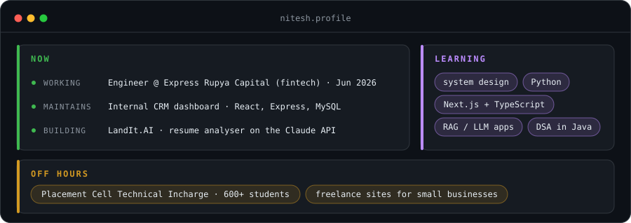
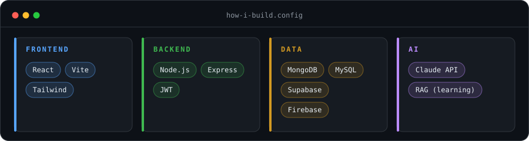

<h1 align="center">Nitesh Salian</h1>

  <code>full-stack engineer → AI product engineer</code> 
  Mumbai · BSc IT, CGPA 8.6

  

---

## How I build

  

---

## Shipped & in progress

| Project | Problem it solves | Stack | Code |
|---|---|---|---|
| **LandIt.AI** | Tells you why your resume fails an ATS: score, keyword gaps, rewrite suggestions | React, Node.js, Claude API | [repo](https://github.com/nitesh8652/LandIt.AI) |
| **JobEase** | Job portal with separate recruiter and job-seeker dashboards, AI resume builder, demand graphs | MongoDB, Express, React, Node.js, Recharts | [repo](https://github.com/nitesh8652/JobEase) |
| **ClipSync** | Copy on one device, paste on another | React, Vite, Firebase Firestore, Cloudinary | [repo](https://github.com/nitesh8652/ClipSync) |
| **Tasker** | Tasks with Google sign-in, calendar view and emailed reminders | React, Supabase, Edge Functions | [repo](https://github.com/nitesh8652/Tasker) |
| **URL Shortener** | Short links, frontend and backend deployed as separate services | Express, React, MongoDB Atlas, Render | [repo](https://github.com/nitesh8652/URL-Shortener) |

---

## Outside the editor

- **Aagaaz (college fest), Social Media Head**: grew the page from 300–500 followers to 2,000+
- **CorePlus**: smart safety helmet, 2nd place in an intra-college IoT competition

---

## Contact

