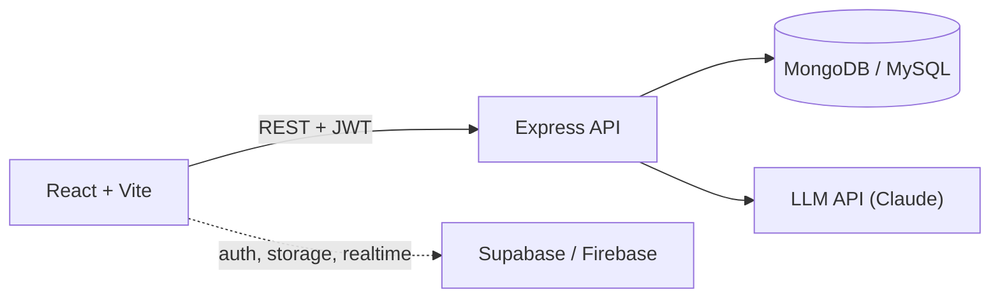

<h1 align="center">Nitesh Salian</h1>

<p align="center">
  <code>full-stack engineer → AI product engineer</code><br/>
  Mumbai · Engineer @ Express Rupya Capital · BSc IT, CGPA 8.6
</p>

```ts
const nitesh = {
  day_job:   "Engineer @ Express Rupya Capital (fintech), since Jun 2026",
  maintains: "internal CRM dashboard: React, Node/Express, MySQL (Sequelize)",
  building:  "LandIt.AI, a resume analyser on the Claude API",
  learning:  ["system design", "Next.js + TypeScript", "RAG / LLM apps", "Python", "DSA in Java"],
  off_hours: ["Placement Cell Technical Incharge (600+ students)", "freelance sites for small businesses"],
  contact:   "see bottom of page",
};
```

---

## How I build

Most of my projects are some variation of this shape:



---

## Shipped & in progress

| Project | Problem it solves | Stack | Code |
|---|---|---|---|
| **LandIt.AI** | Tells you why your resume fails an ATS: score, keyword gaps, rewrite suggestions | React, Node.js, Claude API | [repo](https://github.com/nitesh8652/LandIt.AI) |
| **JobEase** | Job portal with separate recruiter and job-seeker dashboards, AI resume builder, demand graphs | MongoDB, Express, React, Node.js, Recharts | [repo](https://github.com/nitesh8652/JobEase) |
| **ClipSync** | Copy on one device, paste on another | React, Vite, Firebase Firestore, Cloudinary | [repo](https://github.com/nitesh8652/ClipSync) |
| **Tasker** | Tasks with Google sign-in, calendar view and emailed reminders | React, Supabase, Edge Functions | [repo](https://github.com/nitesh8652/Tasker) |
| **URL Shortener** | Short links, frontend and backend deployed as separate services | Express, React, MongoDB Atlas, Render | [repo](https://github.com/nitesh8652/URL-Shortener) |

---

## Outside the editor

- **Placement Cell, Technical Incharge**: handle the technical side of placements for 600+ students
- **Aagaaz (college fest), Social Media Head**: grew the page from 300–500 followers to 2,000+
- **CorePlus**: smart safety helmet, 2nd place in an intra-college IoT competition

---

## Stack


---

## Contact

[](https://linkedin.com/in/nitesh-salian-4792602a4/)
[](mailto:niteshsalian8652085233@gmail.com)
[](https://instagram.com/_niteeesh)
